<!-- Personal profile: keep claims grounded in public repositories and learning profiles. -->

  

<h1 align="center">Hi, I'm Kartik 👋</h1>

  <strong>Aspiring cybersecurity professional · Programmer · Hands-on learner</strong> 
  Online as <code>BL4CK0UTS3C</code>

  
  
  

## 👨‍💻 About me

I'm an **aspiring cybersecurity professional and programmer**, building my foundation through Linux, networking, scripting, and hands-on security labs. I use this GitHub profile to share the technical side of that journey: what I'm learning, what I'm practicing, and what I'm building.

### Systems first

My security learning starts with understanding how a system behaves. In Linux, that means working with files, permissions, users, processes, services, logs, and SSH. In networking, it means connecting concepts such as TCP/IP, DNS, DHCP, and NAT to the way devices communicate. My public notes and lab repositories help me organize these fundamentals and revisit them as I progress.

### Code as a practical tool

I work with **Python and Bash** while developing my programming and scripting skills. I'm interested in using code to make repetitive tasks easier and to turn a concept into something I can test. My **Skill-Build** project extends that interest into web development with Flask, a browser-based interface, learning resources, quizzes, and progress tracking.

### Security through practice

I practice on **TryHackMe and Hack The Box** as **BL4CK0UTS3C**, connecting foundational knowledge to guided exercises and challenges. My interests include ethical hacking, Linux security, network security, and understanding how applications work. I aim to develop the ability to explain a problem, investigate it methodically, and communicate what I learn.

### What you'll find here

- **Learning notes** that turn technical topics into references I can reuse.
- **Labs and exercises** that connect theory to practical system behavior.
- **Scripting practice** as I grow my Python and Bash skills.
- **Application projects** where I explore web development and data analysis.

> **My approach:** learn the fundamentals → practice in labs → document the process → build something useful.

  

## 🎯 What I'm working on

| Focus | What I'm exploring |
| :--- | :--- |
| **Linux & systems** | Users, permissions, processes, services, logs, SSH, and command-line workflows |
| **Networking** | TCP/IP, OSI, IP addressing, DNS, DHCP, NAT, and how traffic moves |
| **Scripting** | Bash practice and Python programming for problem solving and automation |
| **Security practice** | Cybersecurity fundamentals and ethical hacking through TryHackMe and Hack The Box |
| **Building applications** | A learning platform combining Flask, web technologies, and data analysis |

**Interests:** ethical hacking, system security, network security, automation, and learning by building.

## 🧰 Technologies I'm learning & using

  
  
  
  
  
  
  
  
  

## 🚀 Projects & learning repositories

### [Skill-Build ↗](https://github.com/Kartik-git00/Skill-Build)
A learning and resource platform with an initial focus on Computer Science. Includes courses, lessons, quizzes, and progress tracking, with analytics and forecasting features described in the project.

**Built with:** Python · Flask · HTML · CSS · JavaScript · Supabase · Pandas

### [Linux Fundamentals ↗](https://github.com/Kartik-git00/linux-fundamentals)
My Linux learning notebook: hands-on labs, command references, and exercises covering navigation, file management, access control, networking, services, logs, SSH, and Bash.

### [Networking Fundamentals ↗](https://github.com/Kartik-git00/Networking)
Notes and learning materials covering network models, devices, addressing, core protocols, and the journey of a request across a network.

### [Bash Scripting ↗](https://github.com/Kartik-git00/Bash-Scripting)
A dedicated repository for my Bash scripting practice.

<a href="https://github.com/Kartik-git00?tab=repositories">Explore all my public repositories →</a>

## 🧪 Hands-on security journey

I practice as **BL4CK0UTS3C** on [TryHackMe](https://tryhackme.com/p/BL4CK0UTS3C) and [Hack The Box](https://profile.hackthebox.com/profile/019ea097-ae20-71cc-9788-826a48f57d0d).

| TryHackMe milestone | Progress |
| :--- | :--- |
| **Learning path** | Pre Security completed |
| **Best streak** | 98 days |
| **Global ranking** | Top 7% |
| **Highest league** | Silver |

Milestones verified from my public TryHackMe profile on 20 November 2026. Rankings change; visit the profile for current progress.

On Hack The Box, my public badges include **Cyber starter**, **Solid basis**, and **Everything is connected**.

<strong>How I approach learning</strong>

- Understand the Linux and networking concepts behind a lab.
- Practice, troubleshoot, and revisit the parts I find difficult.
- Keep notes and command references I can use again.
- Connect the fundamentals to security and automation.

## 🤝 Let's connect

Interested in cybersecurity, Linux, networking, or building useful tools? Connect with me on [LinkedIn](https://www.linkedin.com/in/kartik-cyber00/) to exchange ideas and learning resources.

  <strong>Stay curious. Keep practicing. Build in public.</strong> 
  Kartik · BL4CK0UTS3C

